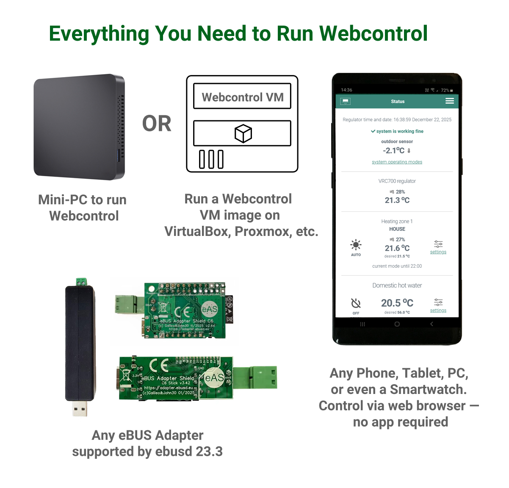

# Webcontrol
**Complete easy to use self-hosted standalone solution built on top of ebusd to replace Vaillant remote control system (MultiMATIC, SensoAPP,  MyVaillant, etc.)** 

  
Want to learn more about Webcontrol and explore its development history? Check out the [Webcontrol News & Updates](https://stadid.github.io/webcontrol-news/) archive.

ℹ️ To read the news feed in your preferred language, please use your browser's built-in translator or an online translation tool.

***

[See Webcontrol Wiki for the program description and information on how to download, install and setup](https://github.com/stadid/webcontrol/wiki)

***

## Want to quickly try out and evaluate Webcontrol?  
[Webcontrol VM image in the *.ova format for importing and running in any supported virtualization environment is available](https://github.com/stadid/webcontrol/releases/tag/v2026.11.14_VM_image) 

 ℹ️ If you’d like to inspect what’s inside the image, root credentials are included in the archive.

***

## Features
• Standalone solution, no external services required. No trackers / telemetry.

• Intuitive lightweight web interface accessible from any device with a web browser (phone, tablet, PC, or even a smartwatch). Most interface controls include descriptive text, helping users understand the changes they are making.

• Features the self-hosted Telegram bot for sending error notifications, current system status reports, and a remote system management.

• Features [NTFY](https://ntfy.sh) service support for sending push notifications on current system errors, system status reports, and a remote system management.

• Always actual readings of the system settings and parameters - they are read from the system on the fly when the corresponding interface page loads.

• Easy setup: simply select which Zones and Circuits you want to display. 

• Compatible with any Vaillant system **featuring supported controller (currently supported all wired generations of VRC700 and VRC720)**. System management is performed via the controller (the same way as it's done by manufacturer).

• Management of the time windows, desired temperatures and special operating modes of the controller.

• Display of the status and error codes for the heat generator(s) installed in the system. Detailed codes explanation available for the supported families of the heat generators: turboTEC, atmoTEC, eloBLOCK, ecoTEC, ecoVIT, ecoCRAFT.

• Heat generators cascade support (for heat generators in cascade the following parameters are available: status code, temperature of the supply and return lines, error code. Sending notification in case of heat generators failure).

• Customizable display of up to 10 user-selected system parameters.

• Multiple user accounts with several permission levels: read only, normal user, specialist.

• Saving and restoring program settings via a configuration file.

• Built-in L2TP/IPsec (PSK) VPN client for remote access to the program's web interface.

• Allows changing all available (in ebusd configuration) settings for the controller and heat generator (experimental function for advanced users).

• Controller settings export into a TXT file.

• Automatic adjustment of the heat curve for selected heating circuits based on outdoor temperature (experimental function for experienced users).

• Automatic date/time correction of the controller clock using an internet-synchronized clock in the Webcontrol mini-PC.

• System control via an external contact (requires a USB GPIO device). Currently one function is implemented for the VRC700 controller.

• Supports both wired (Ethernet) and Wi-Fi connections.

• Program updates via the Internet or via downloadable ZIP package.

## Limitations
• Limited number of supported controllers (VRC700, VRC720). *Other controllers (for example, VRT380) could be added if significant user demand is shown.* No support for systems where controllers are not installed.

• Focus on heating. **Currently** no interface pages for managing cooling / ventilation (some parameters, however, could be set using direct set mode). *Could be added if user interest is shown.*

• No HTTPS encryption for the Web interface. While user authentication is implemented, data is transmitted over plain HTTP. The system should be used only in a controlled environment (LAN) with external access via VPN.

• No fuel consumption / energy statistics data interface pages. *Could be added if requested.*

• No integration with smart-home systems. Acts as a pure standalone solution.

## Feature Comparison Table

| Feature / Characteristic | Webcontrol | Ebusd + Home Assistant | myVAILLANT (OEM System) |
| :--- | :--- | :--- | :--- |
| **Architecture & Cloud** | **Local (autonomous).** Web server runs on-premises; no external cloud is required. | **Local (autonomous).** Runs on a home server; cloud connectivity is strictly optional. | **Strictly cloud-dependent.** Relies on Vaillant's servers; loses functionality if cloud access is disrupted. |
| **Client Interface** | Responsive web interface (browser-based) with a engineering-focused design. | Native HA mobile apps (iOS / Android) and fully customizable dashboards. | Native mobile apps (iOS / Android) with a polished, modern consumer design. |
| **Remote Access** | Requires a user-configured external VPN (such as WireGuard, OpenVPN, or Tailscale) or a dedicated public IP (only L2TP/IPsec client is built in). | Via personal VPN, custom domain (Reverse Proxy), or paid cloud service. | Out-of-the-box via the manufacturer's cloud infrastructure. |
| **Notifications & Control** | Two-way Telegram bot, NTFY, SMS gateway (HTTP APIs), Email. | Any messaging platform (Telegram, WhatsApp), Push, SMS (via integrations), voice assistants. | Push notifications within the official mobile app only. |
| **Service Register Access** | **Full.** Built-in UI for reading and writing installer-level parameters. | **Full.** Access to any register via MQTT or CLI, though without a pre-built visual UI. | **Restricted.** Basic end-user settings only (target temperatures, modes, schedules). |
| **Dynamic Heating Curve** | **Out-of-the-box.** Automatically adjusts the heating curve slope based on outdoor temperature. | **Achievable.** Requires custom automations written by the user (YAML / Node-RED). | **None.** Supports manual configuration of a static heating curve only. |
| **VRC Time Synchronization** | **Out-of-the-box.** Automatically restores date and time on the controller after power loss. | **Achievable.** Requires a custom script or automation to broadcast time packets to the eBUS. | **Automatic.** Syncs time via the manufacturer's cloud when online. |
| **Hardware & Ecosystem Integrations** | "Dry contact" hardware input (USB GPIO device) for external triggers, telemetry export to monitoring platforms. | **Unlimited.** Integrates with Zigbee, Z-Wave, Wi-Fi, Modbus, weather forecasts, and whole-home scenes. | Native support for Apple HomeKit, Amazon Alexa, and Google Home (region-dependent). |
| **Setup Complexity** | **Medium.** Ready-to-flash OS image ("flash and run") or pre-configured hardware gateway. | **High.** Requires setting up an HA server, MQTT broker, matching CSV/TSP boiler configs, and UI cards. | **Low.** Plug-and-play installation via QR code pairing in the mobile app. |
| **Cost of Ownership** | Free tier (1 heating circuit, 1 zone) or a one-time fee for a Pro license / pre-built gateway. | **Free** (Open Source); costs limited to your own server hardware and an eBUS adapter. | One-time purchase of an OEM gateway (VR 920 / VR 921 / myVAILLANT connect) plus optional paid app tiers. |

## Key Takeaways

* **myVAILLANT (OEM System)** is the best choice for homeowners who want a **plug-and-play experience** with a polished mobile app and minimal technical setup. However, it comes at the cost of strict cloud dependency, limited access to advanced installer settings, and the risk of losing remote functionality if the vendor's cloud services experience outages or regional restrictions.
* **Webcontrol** hits the sweet spot for users seeking **turnkey local reliability and deep boiler control** without building a smart home server from scratch. It runs completely offline, provides out-of-the-box engineering features (such as installer register access, automatic clock sync, and dynamic heating curve adjustments), and offers resilient notifications via Telegram, NTFY, Email and SMS.
* **Ebusd + Home Assistant** is the ultimate solution for **DIY enthusiasts and smart home power users**. While it requires significant upfront effort to configure MQTT brokers, register maps, and custom dashboards, it unlocks unlimited automation possibilities by tying your Vaillant heating system into your broader smart home ecosystem.

